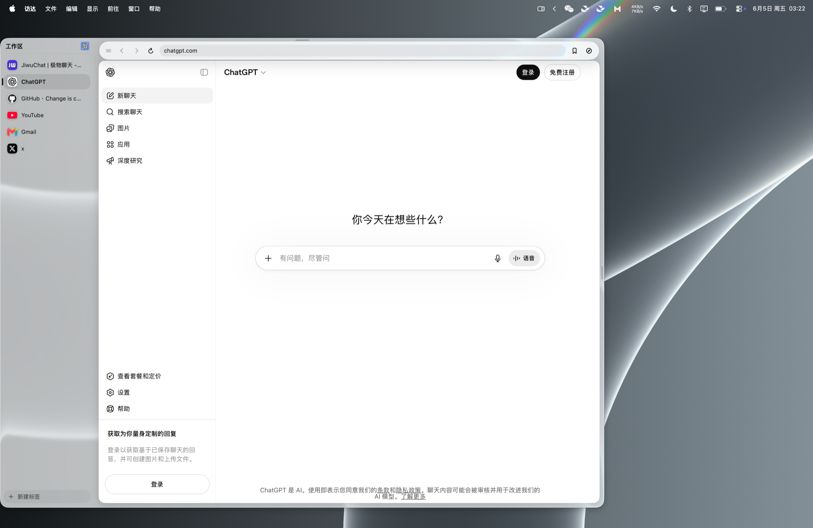

<div align="center">


# Peekr

**为 macOS 打造的原生边缘滑出式 Chromium 浏览器。**

鼠标悬停屏幕边缘，或按全局热键，即可调出网页面板，无需切走当前应用。

[](https://www.apple.com/macos/)
[](#从源码构建)
[](https://github.com/KiWi233333/Peekr/releases)
[](LICENSE)

[English](README.md) · 简体中文



</div>

## 当前源码中的功能

以下描述的是当前源码分支。下载的发行版可能没有这些功能；请以对应版本的
[Release](https://github.com/KiWi233333/Peekr/releases) 和
[更新记录](CHANGELOG.md) 为准。

- **原生面板**：SwiftUI + AppKit 的非激活式滑出面板，支持六个停靠位置、
  拖动缩放、固定、多显示器和可自定义全局热键（默认 `⌃⌥Space`）。
  macOS 26 使用 Liquid Glass，旧系统回退到系统材质。
- **Chromium 浏览**：内置 CEF、持续保活的标签页、可切换搜索引擎的地址栏、
  浏览器快捷键、页内查找、书签、favicon，以及 Chrome Cookie 和书签导入；
  也可从支持的浏览器导入打开的标签页。
- **空间与标签**：可命名的 Spaces、可折叠和彩色的标签组、拖动排序、标签别名，
  以及从网页标题解析的未读数量。空间概览按需捕获当前页面预览；其他卡片使用
  上次可用预览或标签信息。
- **可选的 Agent 接入**：AI Agent 可通过 Chromium DevTools 协议和内置
  `peekr-cli` 在任务空间操作页面。空间区分用户、Agent、交给用户接管三种归属，
  用户可在界面中接管。Agent 接入默认关闭。所有空间共享同一个 Chromium
  Profile，包括 Cookie 和登录态；空间不是独立账号或安全沙箱。

Agent 自动化仍在开发中。CLI 已支持语义化快照、常见页面操作和任务空间交接，
尚未覆盖完整的自动化能力、跨域 iframe、下载和自动操作重试。
具体边界见[实现进度](docs/agent-browser-progress-2026-09-27-interactions.md)。

## 安装与使用

需要 macOS 14 或更新版本。从
[GitHub Releases](https://github.com/KiWi233333/Peekr/releases) 下载可用 DMG，
将 Peekr 拖到「应用程序」。供参考：[v0.2.1](https://github.com/KiWi233333/Peekr/releases/download/v0.2.1/Peekr-0.2.1.dmg)
是 Chromium + WebKit 双引擎历史版本，[v0.1.0](https://github.com/KiWi233333/Peekr/releases/download/v0.1.0/Peekr-0.1.0.dmg)
只包含 WebKit。当前源码分支只使用 Chromium。

- 悬停停靠的屏幕边/角，或按 `⌃⌥Space` 打开面板。
- 从菜单栏图标打开「偏好设置」（`⌘,`）、控制面板或退出。
- 面板内用 `⌘L` 聚焦地址栏、`⌘F` 页内查找、`⌘R` 刷新、
  `⌘W` 关闭标签、`⌘1`–`⌘9` 切换标签。
- 设置、空间与标签、书签、图标及 Chromium Profile 位于
  `~/Library/Application Support/Peekr/`。

### 让 Agent 使用 Peekr

在包含 Agent 接入的构建中，打开**偏好设置 → 浏览器 → Agent 接入**，
启用后重启 Peekr。启用期间应用会写入
`~/Library/Application Support/Peekr/agent.json`。调试端点只在本机开放，
但本机其他进程在启用期间也能连接。CLI 需要 Node.js 22 或更新版本。

可点击该设置中的**安装命令行工具**，将命令注册到
`~/.local/bin/peekr`；也可直接运行应用包内的启动器。若还要为 Codex 和
Claude Code 安装 `peekr-cli` Skill，执行：

```bash
peekr install
peekr doctor
```

`doctor` 确认可连接后，可以运行：

```bash
peekr nodejs <<'EOF'
const task = await taskSpace('example')
const page = task.page('home')
await page.goto('https://example.com')
cliLog(await page.snapshot())
EOF
```

任务空间 API 和首个 heredoc 示例见 [CLI 指南](skills/peekr-cli/SKILL.md)
与[安装说明](skills/peekr-cli/references/install.md)。

## 从源码构建

需要 macOS 14+ 和 Xcode。编译完整的 macOS 26 Liquid Glass 路径需要
Xcode 26。构建流程会准备固定版本的 CEF，并把 Chromium Framework
及 Helper 进程打进完整的 `.app`；不能只用 `swift run` 启动。

```bash
# 在包含当前分支改动的源码目录中运行
make build   # 快速 Swift 编译检查
make dev     # 构建并启动 InjectionIII 热更新 Debug .app，随后持续显示日志
make inject  # 重新构建并启动注入用 Debug .app
make app     # 构建 Release build/Peekr.app
make run     # 构建并打开 Release .app
make dmg     # 构建 Release DMG：dist/Peekr.dmg
swift test
```

`make dev` 会准备 CEF Debug 应用包，用 xcodebuild 构建注入用 Debug 产物，
打开 InjectionIII 和当前仓库，然后启动热更新版本。终端会持续跟踪 Chromium
的 `debug.log`，按 `Ctrl+C` 会停止日志输出并关闭开发中的 Peekr 进程。修改已接入的
SwiftUI 视图并保存即可热更新；启动流程、Package.swift 和新增文件仍需重启。
`make inject` 可以跳过 CEF 打包，重新构建并启动注入用 App。

## 参与贡献

请阅读[贡献指南](CONTRIBUTING.md)、[路线图](ROADMAP.md)和
[行为准则](CODE_OF_CONDUCT.md)。

## 许可证

[MIT](LICENSE) © KiWi233333
